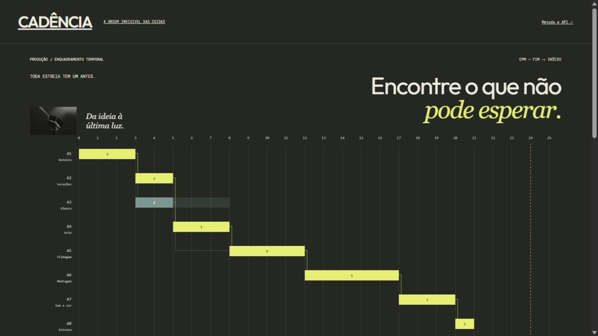
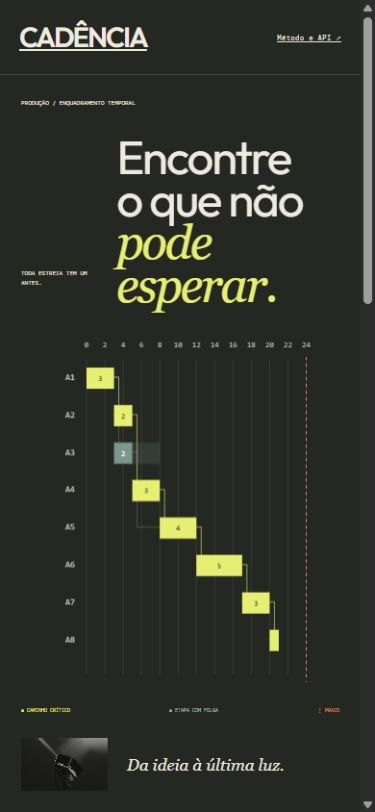

# Validação — CADÊNCIA

Conferência em 2026-11-01. Demo: [CADÊNCIA](https://cadencia-gustapaz.starrylinen.chatgpt.site).

- 20 testes de domínio, API e D1 aprovados; o lote completo soma 215 testes.
- Build de produção, TypeScript e formatação aprovados. CI reproduz os testes no GitHub.
- Smoke HTTP público aprovado: saúde do banco, domínio, rejeição de entrada extra, criação, leitura privada, isolamento, edição, revisão antiga/CAS, publicação, exportação, encerramento do link, remoção do registro de teste, HTML e OpenAPI.
- Navegador público: calcular, guardar, reler, criar link e baixar o arquivo da revisão salva.
- Desktop e larguras de 390 e 768 px verificadas. Com barra de rolagem, as áreas úteis observadas foram 375 e 753 px; nenhuma rolagem horizontal após as correções.
- Roteiro de 3 para 4 dias persistido e relido; CSV confirma duração 4; dependência circular rejeitada pelo servidor.
- Exportação verificada: `cadencia.csv`, 245 bytes, SHA-256 `106a523675658e3dd65f2db50ee8d1cdcbcc805a27458304001e11d773f2f8a2`.

## Evidências visuais

## Publicação e limites

Commit da aplicação publicada: `f98b79bfe369b57ba1ca4b4633a695beb2b265a7`. Commits posteriores que acrescentam estas evidências não alteram o bundle da aplicação.

Dados de demonstração sintéticos, retenção de sete dias, limite global de doze novos registros por hora UTC e até trinta revisões por registro. Edição autorizada por chave aleatória guardada nesta aba; um link público permite leitura. A demo não promete disponibilidade ilimitada nem armazenamento permanente. Nenhum cartão, trial ou faturamento foi ativado.

Não há nota Lighthouse declarada nem certificação de conformidade: as verificações acima descrevem os testes efetivamente executados.
